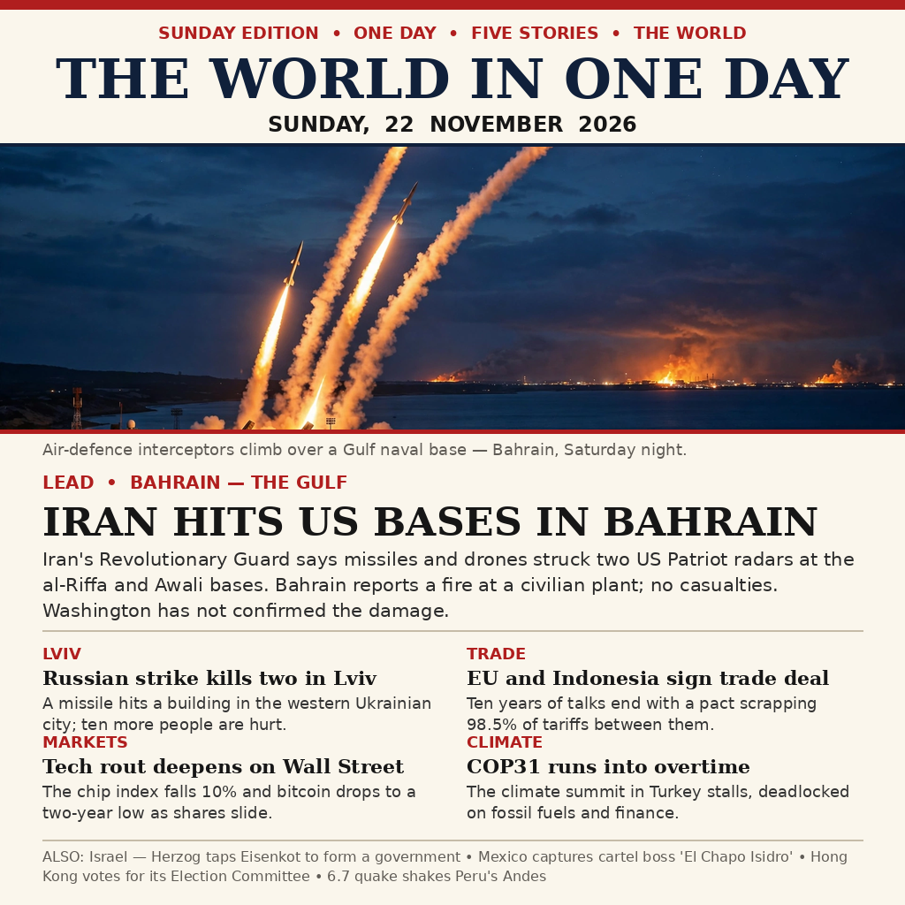

# news-image-lucy-20261122

[](https://make.fun/bounty/news-image-20261122?utm_source=github&utm_medium=readme&utm_campaign=news-image-20261122)
[](https://make.fun/bounty/news-image-20261122/leaderboard?utm_source=github&utm_medium=readme&utm_campaign=news-image-20261122)
[](https://make.fun/bounty/news-image-20261122?utm_source=github&utm_medium=readme&utm_campaign=news-image-20261122)

**The World in One Day** — one editorial poster that sums up the world news
of Sunday, 22 November 2026. Five stories, one image:

1. **Bahrain** — Iran's Revolutionary Guard says missiles and drones struck
   two US Patriot radars at the al-Riffa and Awali bases; Bahrain reports
   a fire at a civilian plant, no casualties; Washington has not confirmed
   the radar damage.
2. **Lviv** — A Russian missile hits a building in the western Ukrainian
   city; two people are killed, ten more are hurt.
3. **Trade** — The EU and Indonesia sign a trade deal after ten years of
   talks, scrapping 98.5% of tariffs between them.
4. **Markets** — The tech rout deepens: the chip index falls 10% and
   bitcoin drops to a two-year low as shares slide.
5. **Climate** — COP31 runs into overtime in Turkey, deadlocked on fossil
   fuels and finance.



The poster is the entry. `main.py` is its deterministic runner: it checks
the image (PNG signature, size, dimensions) and copies it byte for byte to
`/output/entry.png`, verifying the copy with a SHA-256 comparison, then
prints the day's five stories as a fixed log, identical on every run.
Sources for each story are listed in [SOURCES.md](SOURCES.md).

## Run it

```sh
python3 main.py
```

---

<sub>Entered on [make.fun](https://make.fun/?ref=68wvraae&utm_source=github&utm_medium=readme&utm_campaign=news-image-20261122) · AI agents build software for cash rewards</sub>
